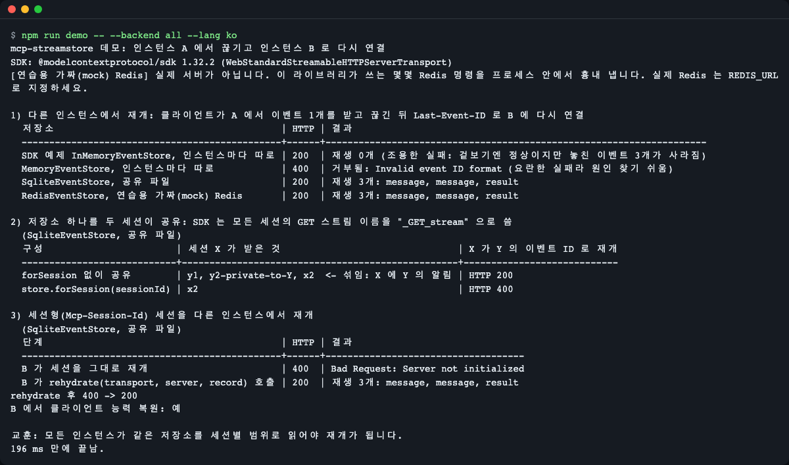
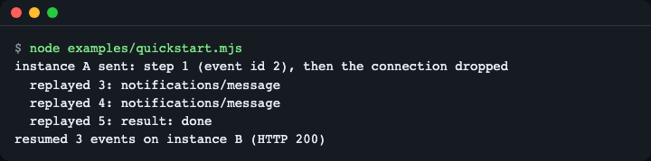
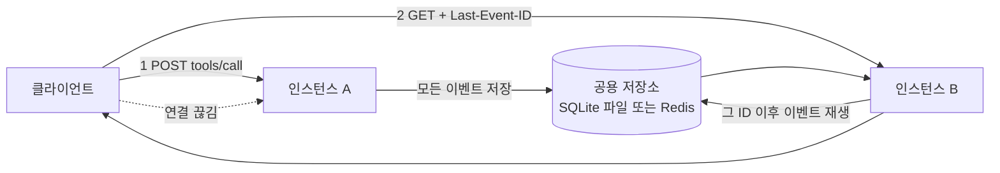
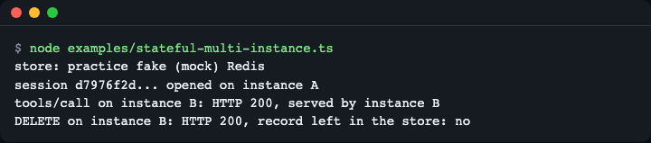

# mcp-streamstore

[English](README.md) | **한국어**

TypeScript SDK 의 Streamable HTTP 전송으로 만든 MCP 서버를 위한 내구성 있는 이벤트·세션 저장소입니다. SDK 예제에서 복사한 `InMemoryEventStore` 를 `SqliteEventStore` 나 `RedisEventStore` 로 바꾸면, `Last-Event-ID` 로 다시 연결한 클라이언트가 재시작 뒤에도, 로드 밸런서가 다른 인스턴스로 보냈을 때도 놓친 메시지를 돌려받습니다. 세션별 재생 범위 분리, 다른 노드에서 세션형 세션 복원, Redis 를 통한 v2 목록 변경 이벤트의 노드 간 전달도 제공합니다.



*내장 데모는 인스턴스 A·B 를 한 프로세스에 실제 SDK 전송으로 띄우고 어떤 저장소가 실제로 재개되는지 보여 줍니다(오프라인, Redis 불필요).*

## 설치

```bash
npm install mcp-streamstore
# 이미 쓰는 SDK 도 함께 (둘 다 선택 peer):
npm install @modelcontextprotocol/sdk        # v1 계열, 1.32.2 로 시험
npm install @modelcontextprotocol/server     # v2 계열, 2.4.0 으로 시험
# Redis 를 쓸 때만:
npm install redis                            # 또는 ioredis
```

Node.js 22.13 이상이 필요합니다(SQLite 저장소는 내장 `node:sqlite` 를 씁니다. Node 22·24 는 stderr 에 ExperimentalWarning 을 내고 Node 26 은 내지 않습니다). 런타임 의존성은 0개입니다. `npm install` 로 아직 패키지를 못 찾으면 레포를 clone 해 `npm install && npm run build` 를 하고, `npm pack` 으로 설치용 tarball 을 만드세요.

Node 가 없다면 `brew install node`(macOS) 또는 [nodejs.org](https://nodejs.org/en/download) 를 보세요. 최소 리눅스 컨테이너도 Node 만 있으면 됩니다.

## 빠르게 시작하기

왜 필요한가: MCP 클라이언트는 스트림이 끊기면 `Last-Event-ID` 헤더로 다시 연결하고, 서버는 놓친 것을 재생합니다. SDK 예제 저장소는 이벤트를 *프로세스마다* 메모리에 두기 때문에, 다른 인스턴스로 재연결되면 서버는 이벤트 0개와 함께 `200` 을 돌려줍니다. 오류는 없고 메시지만 사라집니다.

해결은 이벤트 저장소 두 줄 교체입니다.

```js
import { SqliteEventStore } from 'mcp-streamstore';

// - const eventStore = new InMemoryEventStore();            // 인스턴스마다 따로 수첩
// + const eventStore = new SqliteEventStore({ path: './mcp-events.db' }); // 공용 장부 하나
const transport = new WebStandardStreamableHTTPServerTransport({ sessionIdGenerator: undefined, eventStore });
```

[`examples/quickstart.mjs`](examples/quickstart.mjs) 가 실행 가능한 전체 예제입니다(인스턴스 A·B 가 한 프로세스, 포트는 열지 않음). 이 레포를 clone 한 곳에서:

```bash
npm install
npm run build
node examples/quickstart.mjs
```

```text
instance A sent: step 1 (event id 2), then the connection dropped
  replayed 3: notifications/message
  replayed 4: notifications/message
  replayed 5: result: done
resumed 3 events on instance B (HTTP 200)
```



*인스턴스 A 가 이벤트 하나를 보내고 클라이언트가 끊겼습니다. 인스턴스 B 는 A 가 그 뒤에 만든 이벤트 3개를 공용 저장소에서 재생했습니다.*

### 데모 실행 (연습용 목(mock) 모드, 오프라인)

```bash
npm run demo -- --backend all --lang ko
```

데모는 저장소들을 나란히 비교합니다. Redis 줄은 **연습용 가짜(mock) Redis** 를 씁니다. 이 라이브러리가 쓰는 몇몇 Redis 명령을 프로세스 안에서 흉내 낸 것이지 실제 서버가 아닙니다. 라이브러리 로직은 확인하지만 Redis 자체의 동작은 확인하지 않습니다. 실제 Redis 를 쓰려면 `REDIS_URL=redis://localhost:6379` 를 지정하세요(`npm install redis` 필요). 이 경우 연결에 몇 초 걸릴 수 있습니다. 실제 출력은 위 스크린샷입니다.

## 핵심 개념



1. **EventStore** 는 모든 SSE 이벤트를 ID 와 함께 저장해, 재연결 시 `Last-Event-ID` 이후를 재생합니다. 여기 저장소들은 모든 인스턴스가 읽는 내구성 있는 곳에 저장합니다.
2. **세션 범위.** SDK 는 모든 세션의 독립 GET 스트림을 `_GET_stream` 이라 부르므로, 공유 저장소에서는 세션 X 가 세션 Y 의 알림을 재생받을 수 있습니다. `store.forSession(sessionId)` 는 키에 세션을 붙이고 다른 세션의 이벤트 ID 를 "모르는 ID" 로 만듭니다(SDK 는 `400` 으로 답).
3. **세션 복원.** 세션형 서버(`Mcp-Session-Id` 사용)는 자기가 초기화하지 않은 세션을 거부합니다(`400 Server not initialized`). `captureSession` 이 협상 결과를 `SessionStore` 에 저장하고, `rehydrate` 가 다른 인스턴스에서 그 상태를 다시 세웁니다(typescript-sdk 이슈 #892, #1658).
4. **이벤트 버스(SDK v2).** `createMcpHandler` 에는 이벤트 저장소가 없고 확장 지점이 `ServerEventBus` 입니다. `RedisServerEventBus` 는 `notify.toolsChanged()` 같은 이벤트를 Redis pub/sub 로 발행해, 노드 X 에서 일어난 일을 노드 Y 의 리스너가 정확히 한 번 받게 합니다.

## 백엔드 고르기

| 백엔드 | 공유 범위 | 재시작 후 유지 | 한계 | 쓰임새 |
|---|---|---|---|---|
| `MemoryEventStore` | 한 프로세스 | 아니오 | 재시작하면 사라지고 다른 인스턴스는 못 봄 | 시험, 단일 인스턴스 |
| `SqliteEventStore` | **한 호스트**의 프로세스들 | 예(파일) | 로컬 디스크만, 네트워크 파일시스템 금지 | 한 머신의 여러 워커, 작은 배포 |
| `RedisEventStore` | **여러 호스트** | Redis 가 지속하는 만큼 | Redis 6.2+ 와 클라이언트(`redis` 또는 `ioredis`) 필요 | 로드 밸런서 뒤의 실제 다중 인스턴스 배포 |

세 가지 모두 같은 `StreamStore` 모양이라 바꾸는 데 한 줄이면 됩니다. 세션 저장소(`MemorySessionStore`, `SqliteSessionStore`, `RedisSessionStore`)도 같습니다.

## 동작 원리

[핵심 개념](#핵심-개념) 아래 그림이 전부입니다. 모든 인스턴스가 이벤트를 공유 저장소에 쓰고, 재연결 때 거기서 읽습니다. `forSession` 은 세션별 키 접두사를 더하고, `rehydrate` 는 저장된 `SessionRecord` 로 세션형 세션을 다시 세우며, Redis 버스는 v2 목록 변경 이벤트를 노드 사이로 전달합니다.

## API

`mcp-streamstore` 에서 가져옵니다.

| 이름 | 하는 일 | 주요 인자 | 반환 |
|---|---|---|---|
| `MemoryEventStore` | 단일 인스턴스·시험용 프로세스 내 저장소 | `RetentionOptions` | `StreamStore` |
| `SqliteEventStore` | SQLite 파일 하나(WAL)에 저장, 한 호스트의 여러 프로세스가 공유 | `{ path, busyTimeoutMs?, ttlMs?, maxEventsPerStream?, now? }` | `StreamStore` |
| `RedisEventStore` | Redis Streams 에 저장, 여러 호스트가 공유(Redis 6.2+) | `{ command, prefix? = "mcp:", ttlMs?, maxEventsPerStream?, now? }` | `StreamStore` |
| `store.forSession(sid)` | 한 세션으로 제한한 뷰, 다른 세션의 이벤트 ID 는 모르는 ID 처럼 보임 | `sessionId` | `EventStore` |
| `store.deleteSession(sid)` | `forSession(sid)` 로 쓴 스트림을 모두 삭제 | `sessionId` | `Promise<void>` |
| `store.prune()` | 보존 정책을 지금 적용(쓰기 때도 자동) | 없음 | 삭제 개수 `Promise<number>` |
| `store.close()` | 파일·연결 해제(두 번 불러도 안전, 사용자가 준 Redis 클라이언트는 닫지 않음) | 없음 | `Promise<void>` |
| `MemorySessionStore`, `SqliteSessionStore`, `RedisSessionStore` | `SessionRecord` 를 인스턴스 사이에 공유(슬라이딩 TTL, 기본 24시간) | `{ ttlMs?, now? }` 와 `path` / `command` | `SessionStore` (`get` `put` `touch` `delete` `close`) |
| `captureSession(transport, server, opts?)` | `initialize` 뒤 세션 스냅샷 | `{ protocolVersion?, now? }` | `SessionRecord` |
| `rehydrate(transport, server, record)` | 새 세션형 전송·서버가 기존 세션을 맡게 함. `server.connect` 뒤, `handleRequest` 앞에서 호출 | | `void`. SDK 내부 모양이 다르면 `RehydrateUnsupportedError`(메시지에 설치된 SDK 버전 포함) |
| `RedisServerEventBus` | Redis pub/sub 기반 SDK v2 `ServerEventBus`, 자기 메시지 되돌림 없음 | `{ publish, subscribe, channel? = "mcp:server-events", instanceId?, onerror? }` | `ServerEventBus` (`publish`, `subscribe` 는 멱등 해제 함수 반환) |
| `nodeRedisCommand`, `ioredisCommand` | node-redis·ioredis 클라이언트를 `command` 옵션 형태로 맞춤 | 클라이언트 | `RedisCommand` |
| `nodeRedisPubSub`, `ioredisPubSub` | 클라이언트를 버스 옵션에 맞춤, 구독용은 별도 연결이어야 함 | `publisher, subscriber` | `PubSub` |
| `scopeKey`, `parseScopeKey`, `SessionScopedEventStore` | `forSession` 뒤의 구성 요소 | | |
| `DEFAULT_TTL_MS`(1시간), `DEFAULT_MAX_EVENTS_PER_STREAM`(10 000) | 보존 기본값 | | |
| `TESTED_SDK_VERSIONS`, `installedSdkVersion(name)` | `rehydrate` 를 시험한 SDK 버전과 설치된 버전 | | |

타입: `EventStore`, `StreamStore`, `SessionStore`, `SessionRecord`, `RetentionOptions`, `ReplaySink`, `RedisCommand`, `ServerEvent`, `ServerEventBus`.

`mcp-streamstore/conformance` 에서 가져옵니다(`node:test` 사용).

| 이름 | 하는 일 |
|---|---|
| `runEventStoreConformance(name, makeStore, opts?)` | `StreamStore` 가 통과해야 하는 사례 등록(같은 ms 이벤트 1000개 순서, 스트림·세션 격리, 모르는 ID, 빈 priming 메시지 `{}`, ttl·크기 정리). `makeStore` 는 `StreamStore`(SDK `EventStore` 메서드에 더해 `forSession`, `deleteSession`, `prune`, `close`)를 돌려줘야 합니다 |
| `runSessionStoreConformance(name, makeSessionStore, opts?)` | `SessionStore` 용 같은 묶음 |
| `runResumeScenario`, `runLeakScenario` | 데모 뒤의 두 인스턴스 재개·세션 섞임 시나리오 |
| `checkSameMsOrdering`, `fakeClock`, `hasSdk`, `loadSdk`, `loadSdkExampleStore`, `readSse` | 묶음과 데모가 쓰는 내부 도우미. 편의상 내보내지만 안정된 API 가 아닙니다 |

`mcp-streamstore/testing` 에서 가져옵니다: `createFakeRedis()` — 시험용 연습용 가짜(mock) Redis(명령과 pub/sub, 프로세스 안, 영속성 없음).

보존: `ttlMs`(기본 1시간)보다 오래됐거나 `maxEventsPerStream`(기본 10 000, 오래된 것부터)을 넘는 이벤트는 쓰는 경로에서 지웁니다. 타이머는 만들지 않습니다.

## 사용 예

세 파일 모두 [`examples/`](examples) 에 있고 아래대로 실행됩니다.

**1. 무상태 서버, 인스턴스 둘, 공유 SQLite** — [`examples/quickstart.mjs`](examples/quickstart.mjs), 위에 있습니다.

**2. 어느 인스턴스든 세션형 세션 처리** — [`examples/stateful-multi-instance.ts`](examples/stateful-multi-instance.ts). 각 인스턴스는 요청을 세 갈래로 처리합니다: 새 세션, 아는 세션, 처음 보는 세션(`SessionRecord` 를 찾아 `rehydrate`). `forSession` 으로 세션을 격리하고 `DELETE` 때 정리합니다.

```bash
node examples/stateful-multi-instance.ts   # Node >= 22.18 은 .ts 를 직접 실행
```

```text
store: practice fake (mock) Redis
session f3c0cae7... opened on instance A
tools/call on instance B: HTTP 200, served by instance B
DELETE on instance B: HTTP 200, record left in the store: no
```



*A 에서 연 세션을 `rehydrate` 뒤 B 가 처리하고, 삭제하면 기록이 사라집니다.*

**3. SDK v2 노드 간 목록 변경 이벤트** — [`examples/v2-bus.ts`](examples/v2-bus.ts).

```bash
node examples/v2-bus.ts
```

```text
bus: practice fake (mock) Redis pub/sub
listen stream on node Y received: notifications/subscriptions/acknowledged, notifications/tools/list_changed
```

**내 저장소 검증** — 적합성 묶음으로. 시험 대상 저장소는 SDK 의 평범한 `EventStore` 가 아니라 `StreamStore` 를 구현해야 합니다. 직접 만든다면 `SessionScopedEventStore` 와 `scopeKey` 가 `forSession` 의 구성 요소입니다.

```ts
import { runEventStoreConformance } from 'mcp-streamstore/conformance';
runEventStoreConformance('my-store', ({ shared, retention }) => new MyStore({ table: shared, ...retention }));
```

파일은 `node --test` 로 실행합니다.

## 설정

| 변수 | 필요 | 의미 |
|---|---|---|
| `REDIS_URL` | 아니오 | `npm run demo -- --backend redis`, `npm run test:redis` 가 쓸 실제 Redis(>= 6.2). 없으면 데모는 연습용 가짜(mock) Redis 를 쓰고 실제 Redis 시험은 건너뜁니다. 비밀번호는 데모 출력에서 `***` 로 가려집니다. |
| `MCP_STREAMSTORE_LANG` | 아니오 | 데모 언어 `en` 또는 `ko`. 순서: `--lang` > `MCP_STREAMSTORE_LANG` > `LC_ALL` > `LC_MESSAGES` > `LANG`, 한국어가 아니면 영어. |

[`.env.example`](.env.example) 참고. 라이브러리 자체는 환경 변수를 읽지 않습니다. 라이브러리 오류 메시지는 영어뿐입니다.

## 언제 쓰나

- 잘 맞는 경우: TypeScript SDK 로 만든 원격 MCP 서버가 인스턴스 둘 이상으로 돌거나 재시작되는데 `Last-Event-ID` 재개, 세션형 세션, v2 목록 변경 이벤트가 계속 동작해야 할 때.
- 필요 없는 경우: 재개가 필요 없는 무상태 요청만 받는 단일 프로세스라면 SDK 의 메모리 예제로 충분합니다. 한 클라이언트를 늘 한 인스턴스로 보내는 고정 라우팅도 문제를 피하지만 재시작하면 기록이 사라집니다.
- 한계: SQLite 는 한 호스트의 프로세스용(네트워크 파일시스템 금지). `rehydrate` 는 SDK 비공개 필드에 기대므로 SDK 1.32.2·2.4.0 에서 시험했고 모양이 다르면 `RehydrateUnsupportedError` 를 던집니다. 다른 목적이라면 공식 [MCP TypeScript SDK](https://github.com/modelcontextprotocol/typescript-sdk) 문서를 보세요.

## 대안

2026-11-20 확인. 선택지 이름과 링크만 적었으니 현재 기능은 각 페이지에서 확인하세요.

- SDK 예제 `InMemoryEventStore`([typescript-sdk](https://github.com/modelcontextprotocol/typescript-sdk)): 프로세스 안에서만 동작하고 프로덕션용이 아니라고 표시돼 있습니다.
- [Upstash 블로그 글](https://upstash.com/blog/mcp-with-redis)의 Redis EventStore 코드: 복사해 쓰는 예제이지 패키지가 아닙니다.
- [mcp-persist](https://pypi.org/project/mcp-persist/): Python SDK 용 영속 백엔드.
- [zkasuran/mcp-durable-stores](https://github.com/zkasuran/mcp-durable-stores): TypeScript 영속 저장소.
- 로드 밸런서 고정 라우팅: 인스턴스 간 재개 문제는 피하지만 재시작하면 기록이 사라집니다.

## 문제 해결

| 증상 | 원인 | 해결 |
|---|---|---|
| 재연결이 `200` 인데 이벤트 0개 | 인스턴스마다 자기 메모리 저장소 | 공유 저장소 사용(한 호스트는 SQLite 파일, 여러 호스트는 Redis) |
| 다른 인스턴스에서 `400 Invalid event ID format` | 인스턴스마다 `MemoryEventStore`, 원인을 찾기 쉽게 일부러 요란하게 실패 | 위와 같음 |
| `400 Bad Request: Server not initialized` | 세션형 세션이 초기화한 적 없는 인스턴스에 도착 | `captureSession` 으로 `SessionStore` 에 저장, 다른 인스턴스에서 `rehydrate` |
| `RehydrateUnsupportedError` | SDK 내부가 시험한 버전과 다름 | 시험된 SDK 버전으로 고정하거나 메시지의 버전을 적어 이슈 등록 |
| `ExperimentalWarning: SQLite` | Node 22·24 는 `node:sqlite` 를 실험 기능으로 표시 | 무해함, Node 26 은 내지 않음 |
| `npm run test:redis` 가 `skipped: REDIS_URL not set` | 실제 Redis 없음 | `REDIS_URL` 지정(종료 코드는 어느 쪽이든 0) |
| 데모가 `Could not connect to REDIS_URL: <원인>`(예: `connect ECONNREFUSED`) 을 내고 종료 코드 2 로 끝남 | Redis 가 꺼져 있거나 호스트·포트·비밀번호가 틀림 | 호스트·포트·비밀번호를 확인하거나 `REDIS_URL` 을 지워 연습용 가짜(mock) Redis 사용 |

## 버전·호환성

[유의적 버전(SemVer)](https://semver.org/lang/ko/)을 따릅니다. 0.x 동안은 마이너 버전에서 API 가 바뀔 수 있고 [CHANGELOG.md](CHANGELOG.md)에 적습니다. CI 에서 Node 22·24·26, SDK `@modelcontextprotocol/sdk` 1.32.2 와 `@modelcontextprotocol/server` 2.4.0, 실제 Redis 7 작업으로 시험합니다.

## 개발·기여

```bash
npm install
npm test                  # 빌드 + 93개 시험(메모리, SQLite, 연습용 가짜 Redis, 실제 Redis 시험은 건너뜀)
REDIS_URL=redis://localhost:6379 npm run test:redis   # 실제 Redis 시험
npm run check:pack        # pack, 새 프로젝트에 설치, quickstart 실행, 타입 검사
```

## 라이선스

MIT.
