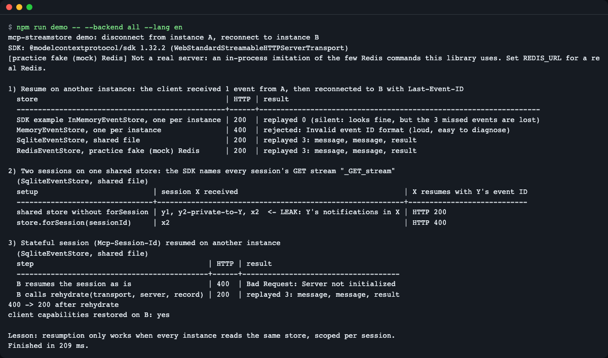
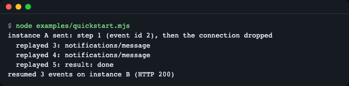
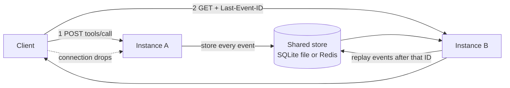
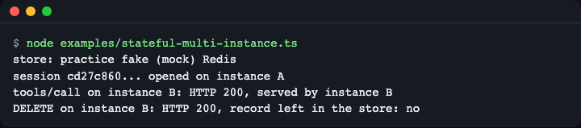

# mcp-streamstore

**English** | [한국어](README.ko.md)

Durable event and session storage for MCP servers built on the TypeScript SDK's Streamable HTTP transport. Swap the copied example `InMemoryEventStore` for `SqliteEventStore` or `RedisEventStore` and a client that reconnects with `Last-Event-ID` gets its missed messages back, even after a restart or when the load balancer sends it to another instance. It also scopes replay per session, rebuilds a stateful session on another node, and carries v2 list-changed events across nodes through Redis.



*The built-in demo runs instance A and instance B in one process with the real SDK transport and shows which store actually resumes (offline, no Redis needed).*

## Install

```bash
npm install mcp-streamstore
# plus the SDK you already use (both are optional peers):
npm install @modelcontextprotocol/sdk        # v1 line, tested with 1.32.2
npm install @modelcontextprotocol/server     # v2 line, tested with 2.4.0
# only if you use Redis:
npm install redis                            # or ioredis
```

Requires Node.js 22.13 or newer (the SQLite store uses the built-in `node:sqlite`; Node 22 and 24 print an ExperimentalWarning to stderr, Node 26 does not). Runtime dependencies: 0. If `npm install` cannot find the package yet, clone the repo and run `npm install && npm run build`, then `npm pack` to get an installable tarball.

Node is not installed? `brew install node` (macOS) or see [nodejs.org](https://nodejs.org/en/download). Minimal Linux containers need only Node itself; nothing else.

## Quick start

Why this exists: an MCP client that loses its stream reconnects with a `Last-Event-ID` header and the server replays what was missed. The SDK's example store keeps events in memory *per process*, so when the reconnect lands on another instance the server answers `200` with zero events: nothing fails, messages are just gone.

The fix is a two-line change, the event store:

```js
import { SqliteEventStore } from 'mcp-streamstore';

// - const eventStore = new InMemoryEventStore();            // one notebook per instance
// + const eventStore = new SqliteEventStore({ path: './mcp-events.db' }); // one shared ledger
const transport = new WebStandardStreamableHTTPServerTransport({ sessionIdGenerator: undefined, eventStore });
```

[`examples/quickstart.mjs`](examples/quickstart.mjs) is the complete runnable version (instance A and B in one process, no ports opened). From a clone of this repo:

```bash
npm install
npm run build
node examples/quickstart.mjs
```

```text
instance A sent: step 1 (event id 2), then the connection dropped
  replayed 3: notifications/message
  replayed 4: notifications/message
  replayed 5: result: done
resumed 3 events on instance B (HTTP 200)
```



*Instance A sent one event, the client dropped, and instance B replayed the 3 events A produced afterwards from the shared store.*

### Try the demo (practice mock mode, offline)

```bash
npm run demo -- --backend all --lang en
```

The demo compares stores side by side. The Redis row uses a **practice fake (mock) Redis**: an in-process imitation of the few Redis commands this library uses, not a real server. It proves the library's logic, not Redis's behaviour. Set `REDIS_URL=redis://localhost:6379` to use a real Redis (needs `npm install redis`); that run can take several seconds to connect. Real output is in the screenshot above.

## Core concepts



1. **EventStore** keeps every SSE event with an ID so a reconnect can replay what came after `Last-Event-ID`. The stores here keep events in a durable place that every instance reads.
2. **Session scoping.** The SDK names every session's standalone GET stream `_GET_stream`, so on a shared store, session X could replay session Y's notifications. `store.forSession(sessionId)` prefixes keys with the session and makes another session's event IDs look unknown (the SDK then answers `400`).
3. **Session rehydration.** A stateful server (with `Mcp-Session-Id`) refuses a session it never initialized (`400 Server not initialized`). `captureSession` saves what the client negotiated into a `SessionStore`; `rehydrate` rebuilds that state on another instance (typescript-sdk issues #892 and #1658).
4. **Event bus (SDK v2).** `createMcpHandler` has no event store; its extension point is a `ServerEventBus`. `RedisServerEventBus` publishes `notify.toolsChanged()` and friends over Redis pub/sub so a listener on node Y hears an event raised on node X, exactly once.

## Choosing a backend

| Backend | Shared by | Survives restart | Limits | Use it for |
|---|---|---|---|---|
| `MemoryEventStore` | one process | no | lost on restart, invisible to other instances | tests, a single instance |
| `SqliteEventStore` | processes on **one host** | yes (file) | local disk only, no network file systems | several workers on one machine, small deployments |
| `RedisEventStore` | **many hosts** | as durable as your Redis | needs Redis 6.2+ and a client (`redis` or `ioredis`) | real multi-instance deployments behind a load balancer |

All three keep the same `StreamStore` shape, so switching is a one-line change. The same applies to the session stores (`MemorySessionStore`, `SqliteSessionStore`, `RedisSessionStore`).

## How it works

The diagram under [Core concepts](#core-concepts) is the whole idea: every instance writes events to one shared store and reads from it on reconnect. `forSession` adds a per-session key prefix, `rehydrate` rebuilds a stateful session from a saved `SessionRecord`, and the Redis bus forwards v2 list-changed events between nodes.

## API

Import from `mcp-streamstore`:

| Name | What it does | Main arguments | Returns |
|---|---|---|---|
| `MemoryEventStore` | In-process store for single instance and tests | `RetentionOptions` | `StreamStore` |
| `SqliteEventStore` | Durable store in one SQLite file (WAL), shared by processes on one host | `{ path, busyTimeoutMs?, ttlMs?, maxEventsPerStream?, now? }` | `StreamStore` |
| `RedisEventStore` | Durable store on Redis Streams, shared across hosts (Redis 6.2+) | `{ command, prefix? = "mcp:", ttlMs?, maxEventsPerStream?, now? }` | `StreamStore` |
| `store.forSession(sid)` | View limited to one session; other sessions' event IDs look unknown | `sessionId` | `EventStore` |
| `store.deleteSession(sid)` | Remove every stream written through `forSession(sid)` | `sessionId` | `Promise<void>` |
| `store.prune()` | Apply retention now (also done on writes) | none | `Promise<number>` removed |
| `store.close()` | Release the file or connection (safe twice; user-supplied Redis clients are never closed) | none | `Promise<void>` |
| `MemorySessionStore`, `SqliteSessionStore`, `RedisSessionStore` | Share `SessionRecord`s between instances (sliding TTL, default 24 h) | `{ ttlMs?, now? }` plus `path` / `command` | `SessionStore` (`get` `put` `touch` `delete` `close`) |
| `captureSession(transport, server, opts?)` | Snapshot a session after `initialize` | `{ protocolVersion?, now? }` | `SessionRecord` |
| `rehydrate(transport, server, record)` | Make a fresh stateful transport and server serve an existing session; call after `server.connect` and before `handleRequest` | | `void`; throws `RehydrateUnsupportedError` (message includes the installed SDK version) when SDK internals differ |
| `RedisServerEventBus` | SDK v2 `ServerEventBus` over Redis pub/sub, no self-echo | `{ publish, subscribe, channel? = "mcp:server-events", instanceId?, onerror? }` | `ServerEventBus` (`publish`, `subscribe` returns an idempotent unsubscribe) |
| `nodeRedisCommand`, `ioredisCommand` | Adapt a node-redis or ioredis client to the `command` option | the client | `RedisCommand` |
| `nodeRedisPubSub`, `ioredisPubSub` | Adapt clients to the bus options; the subscriber must be a separate connection | `publisher, subscriber` | `PubSub` |
| `scopeKey`, `parseScopeKey`, `SessionScopedEventStore` | Building blocks behind `forSession` | | |
| `DEFAULT_TTL_MS` (1 h), `DEFAULT_MAX_EVENTS_PER_STREAM` (10 000) | Retention defaults | | |
| `TESTED_SDK_VERSIONS`, `installedSdkVersion(name)` | SDK versions `rehydrate` was tested against, and the one installed | | |

Types: `EventStore`, `StreamStore`, `SessionStore`, `SessionRecord`, `RetentionOptions`, `ReplaySink`, `RedisCommand`, `ServerEvent`, `ServerEventBus`.

Import from `mcp-streamstore/conformance` (uses `node:test`):

| Name | What it does |
|---|---|
| `runEventStoreConformance(name, makeStore, opts?)` | Registers the cases a `StreamStore` must pass (1000 same-ms events in order, stream and session isolation, unknown ID, empty priming message `{}`, ttl and size pruning). `makeStore` must return a `StreamStore` (`forSession`, `deleteSession`, `prune`, `close` as well as the SDK `EventStore` methods) |
| `runSessionStoreConformance(name, makeSessionStore, opts?)` | Same for a `SessionStore` |
| `runResumeScenario`, `runLeakScenario` | The two-instance resume and session-leak scenarios behind the demo |
| `checkSameMsOrdering`, `fakeClock`, `hasSdk`, `loadSdk`, `loadSdkExampleStore`, `readSse` | Internal helpers used by the suite and the demo; exported for convenience, not a stable API |

Import from `mcp-streamstore/testing`: `createFakeRedis()`, the practice fake (mock) Redis for tests (commands plus pub/sub, in-process, no persistence).

Retention: events older than `ttlMs` (default 1 hour) and beyond `maxEventsPerStream` (default 10 000, oldest first) are dropped on the write path; no timers are started.

## Usage examples

All three files are in [`examples/`](examples) and run as shown.

**1. Stateless server, two instances, shared SQLite** — [`examples/quickstart.mjs`](examples/quickstart.mjs), shown above.

**2. Stateful sessions on any instance** — [`examples/stateful-multi-instance.ts`](examples/stateful-multi-instance.ts). Each instance routes a request three ways: new session, session it knows, or a session it never saw (look up the `SessionRecord`, then `rehydrate`). Also isolates sessions with `forSession` and cleans up on `DELETE`.

```bash
node examples/stateful-multi-instance.ts   # Node >= 22.18 runs .ts directly
```

```text
store: practice fake (mock) Redis
session f3c0cae7... opened on instance A
tools/call on instance B: HTTP 200, served by instance B
DELETE on instance B: HTTP 200, record left in the store: no
```



*A session opened on A is served by B after `rehydrate`; deleting it removes its record.*

**3. SDK v2 cross-node list-changed events** — [`examples/v2-bus.ts`](examples/v2-bus.ts).

```bash
node examples/v2-bus.ts
```

```text
bus: practice fake (mock) Redis pub/sub
listen stream on node Y received: notifications/subscriptions/acknowledged, notifications/tools/list_changed
```

**Verify your own store** with the conformance suite. The store under test must implement `StreamStore`, not just the SDK's plain `EventStore`; `SessionScopedEventStore` and `scopeKey` are the building blocks for `forSession` if you write your own.

```ts
import { runEventStoreConformance } from 'mcp-streamstore/conformance';
runEventStoreConformance('my-store', ({ shared, retention }) => new MyStore({ table: shared, ...retention }));
```

Run the file with `node --test`.

## Configuration

| Variable | Needed | Meaning |
|---|---|---|
| `REDIS_URL` | no | Real Redis (>= 6.2) for `npm run demo -- --backend redis` and `npm run test:redis`. Without it the demo uses the practice fake (mock) Redis and the real-Redis tests are skipped. Passwords are masked (`***`) in demo output. |
| `MCP_STREAMSTORE_LANG` | no | Demo language `en` or `ko`. Order: `--lang` > `MCP_STREAMSTORE_LANG` > `LC_ALL` > `LC_MESSAGES` > `LANG`; anything not Korean falls back to English. |

See [`.env.example`](.env.example). The library itself reads no environment variables. Library error messages are English only.

## When to use it

- Good fit: a remote MCP server on the TypeScript SDK that runs on more than one instance (or restarts) and must keep `Last-Event-ID` resumption, stateful sessions or v2 list-changed events working.
- Not needed: a single long-lived process with stateless requests that never needs resumption, where the SDK's in-memory example is enough. Sticky routing (one client always to one instance) also avoids the problem, at the cost of losing history on restart.
- Limits: SQLite is for processes on one host (no network file systems); `rehydrate` relies on private SDK fields, so it is tested on SDK 1.32.2 and 2.4.0 and throws `RehydrateUnsupportedError` if the shape differs. Different goal? See the official [MCP TypeScript SDK](https://github.com/modelcontextprotocol/typescript-sdk) docs.

## Alternatives

Checked 2026-11-20. This list names the options and links to them; read their pages for current features.

- The SDK's example `InMemoryEventStore` ([typescript-sdk](https://github.com/modelcontextprotocol/typescript-sdk)): in-process only and marked not for production.
- The Redis EventStore snippet in the [Upstash blog post](https://upstash.com/blog/mcp-with-redis): sample code to copy, not a package.
- [mcp-persist](https://pypi.org/project/mcp-persist/): persistence backends for the Python SDK.
- [zkasuran/mcp-durable-stores](https://github.com/zkasuran/mcp-durable-stores): TypeScript durable stores.
- Sticky routing at the load balancer: avoids cross-instance resume but loses history on restart.

## Troubleshooting

| Symptom | Cause | Fix |
|---|---|---|
| Reconnect returns `200` but 0 events | Each instance has its own in-memory store | Use a shared store (SQLite file on one host, Redis across hosts) |
| `400 Invalid event ID format` on another instance | `MemoryEventStore` per instance, a loud failure by design | Same as above |
| `400 Bad Request: Server not initialized` | Stateful session reached an instance that never initialized it | `captureSession` into a `SessionStore`, then `rehydrate` on the other instance |
| `RehydrateUnsupportedError` | SDK internals differ from the tested versions | Pin SDK to a tested version, or open an issue with the version in the message |
| `ExperimentalWarning: SQLite` | Node 22/24 mark `node:sqlite` experimental | Harmless; Node 26 does not print it |
| `npm run test:redis` says `skipped: REDIS_URL not set` | No real Redis | Set `REDIS_URL` (exit code is 0 either way) |
| Demo prints `Could not connect to REDIS_URL: ...` and exits with code 2 | Redis is not running, or host, port or password is wrong | Check host, port and password, or unset `REDIS_URL` to use the practice fake (mock) Redis |

## Versioning and compatibility

[SemVer](https://semver.org). While 0.x, minor versions may change the API; changes are listed in [CHANGELOG.md](CHANGELOG.md). Tested on Node 22, 24 and 26 in CI, SDK `@modelcontextprotocol/sdk` 1.32.2 and `@modelcontextprotocol/server` 2.4.0, real Redis 7 in a CI job.

## Development and contributing

```bash
npm install
npm test                  # build + 92 tests (memory, SQLite, practice fake Redis; real-Redis suite skipped)
REDIS_URL=redis://localhost:6379 npm run test:redis   # real Redis suite
npm run check:pack        # pack, install into a fresh project, run quickstart, type-check
```

## License

MIT.
